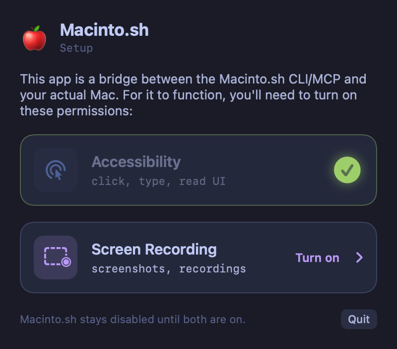
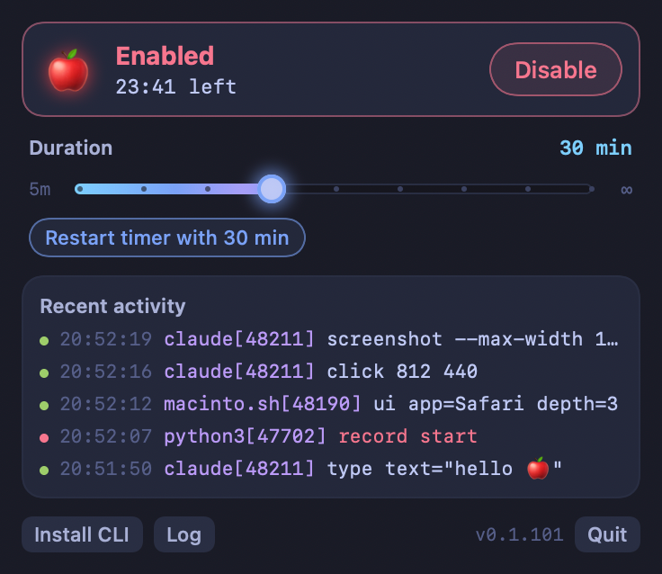

# macinto.sh

A computer use tunnel for macOS. `Macinto.sh.app` is a menu bar app that holds
the Accessibility and Screen Recording permissions. `macinto.sh` is a command
line tool (and MCP server) that asks the app to click, type, press keys, read
the UI tree, take screenshots and record the screen.

Agents and scripts call `macinto.sh`; only the app needs to be trusted by macOS.
The app does nothing until a person enables it from the menu bar, and enabling
is time-limited.

## Install

Requires macOS 15 or later. Universal (Apple silicon and Intel).

Homebrew:

```bash
brew install --cask dorkitude/tap/macinto-sh
```

This installs `Macinto.sh.app` in `/Applications` and links `macinto.sh` into
Homebrew's `bin` (on your `PATH`). Then open the app and finish setup:

```bash
macinto.sh setup
```

Or download the DMG from
[github.com/dorkitude/macinto-sh/releases/latest](https://github.com/dorkitude/macinto-sh/releases/latest),
open it, and drag Macinto.sh to Applications. Open it from Finder or with
`open /Applications/Macinto.sh.app`, then click **Install CLI** in the app (see
below) to put `macinto.sh` on your `PATH`.

`open -a` with the app's name does not work: it reads the `.sh` as a file
extension and reports that it can't find the application. Use
`macinto.sh setup`, `open /Applications/Macinto.sh.app` or
`open -b com.dorkitude.macinto.sh`.

The app is signed with a Developer ID and notarized by Apple. The CLI is a
single native binary inside the app bundle (`Contents/Helpers/macinto.sh`).

## First run

1. Run `macinto.sh setup`. It starts Macinto.sh if it isn't running, then
   brings its window to the front:

   ```
   $ macinto.sh setup
   Macinto.sh is open (started it). Finish setup in its window (accessibility missing, screen recording missing, test capture not done), then enable it.
   ```

   Any other `macinto.sh` command (or the MCP server) also launches the app
   when it isn't running, and waits up to 10 seconds for it. Pass
   `--no-launch` (or set `MACINTO_NO_LAUNCH=1`) to get a `not_running` error
   instead.
2. Until setup is finished, the app shows a setup screen and every request
   except `status`, `permissions`, `screen list` and `keys` fails with code
   `setup`:

   ```
   macinto.sh: Macinto.sh needs setup: finish it in the Macinto.sh window (it's open now), then enable it.
   ```

   The setup screen has one button per permission (each opens the right
   System Settings pane):
   - **Accessibility**: needed for `click`, `move`, `drag`, `scroll`, `type`,
     `key`, `ui`, `press`, `focus`, `set-value`.
   - **Screen Recording**: needed for `screenshot` and `record`. macOS often
     reports this grant only to a new process, so after you turn it on, click
     **Relaunch Macinto.sh**.

   Once both are on, the app takes one test capture (so macOS's "allow direct
   screen capture" prompt appears now, not in the middle of an agent's run),
   then shows a short note about the red apple, then the controls. If a
   permission is turned off later, Macinto.sh disables itself, stops any
   recording, and goes back to the setup screen.
3. Enable it: pick a duration and click **Enable** (see below). Nothing can
   enable it from the command line.

When a request is refused because setup isn't finished, the app brings its
window to the front without activating or taking keyboard focus, so you can
see what's left. `macinto.sh status` shows `state: setup needed`, `disabled`
or `enabled`, and which setup steps remain.

Once enabled:

```
$ macinto.sh status
state: enabled
enabled: yes
remaining: 1712
accessibility: granted
screen_recording: granted
...
$ macinto.sh open TextEdit
$ macinto.sh key cmd+n
$ macinto.sh type "Hello from macinto 🍎"
$ macinto.sh screenshot -o /tmp/screen.png
/tmp/screen.png 1800x1169
```

### Install CLI

Homebrew installs already have `macinto.sh` on `PATH`; the app's footer then
shows **CLI installed ✓**. Otherwise **Install CLI** symlinks
`/usr/local/bin/macinto.sh` to the bundled CLI (one admin password prompt). If
you cancel the prompt, it links `~/.local/bin/macinto.sh` instead and tells you
if `~/.local/bin` isn't on your `PATH`. To do it by hand:

```bash
ln -s /Applications/Macinto.sh.app/Contents/Helpers/macinto.sh /usr/local/bin/macinto.sh
```

### Finding the app

When the CLI needs to launch the app, it uses the first of:

1. `MACINTO_APP=/path/to/Macinto.sh.app`, if set
2. the app bundle the CLI binary itself lives in (symlinks resolved), so the
   Homebrew link and `/usr/local/bin` link launch the app they point into
3. `/Applications/Macinto.sh.app`, `~/Applications/Macinto.sh.app`
4. Spotlight, by bundle id `com.dorkitude.macinto.sh`
5. LaunchServices, by bundle id (`open -b`)

If none is found it exits 1 with code `not_installed` and the install
commands above.

<p>
  
  
</p>

If your menu bar is full, macOS hides new menu bar icons without telling the
app. When that happens Macinto.sh opens the control window on its own. It
appears without taking keyboard focus. Run `macinto.sh setup` at any time
to bring it back (and focus it).

## Enabling, the timer, and the red apple

Macinto.sh starts **disabled** every time it launches. While disabled, every
request except `status`, `permissions`, `screen list` and `keys` is refused:

```
macinto.sh: Macinto.sh is disabled. Enable it from the Macinto.sh menu bar icon, or open its window with: macinto.sh setup
```

To enable it, pick a duration on the slider (5 min to 8 h, default 30 min) and
click **Enable**. When the timer runs out, Macinto.sh disables itself and stops
any recording in progress. The last notch on the slider is ∞, which stays on
until you turn it off.

Enabling needs a person:

- There is no CLI command, socket command or MCP tool that enables it.
- The Enable button is not a default button. Return does nothing; it takes a
  click (or Tab to the button, then Space).
- The control window never takes keyboard focus when it appears on its own, so
  keystrokes meant for another app can't land in it.

While enabled:

- The menu bar icon is a full-color 🍎, and the controls show a small
  pulsing 🍎. When disabled it is a dimmed, gray 🍎.
- A big red apple flashes in the top-right corner of the main screen, just
  below the menu bar. It ignores the mouse, shows on every Space, and is left
  out of Macinto.sh's own screenshots and recordings.

Clicking the menu bar 🍎 brings the control window to the front. It shows the
time remaining, the duration slider, and the last 10 requests: time, calling
process and pid, command. Refused or failed requests are red.

## CLI reference

```
macinto.sh [--json] [--dev] [--no-launch] [--socket PATH] <command> [args]
```

`--socket` (or `MACINTO_SOCKET`) talks to another socket; the CLI only
auto-launches the app for its default socket.

Coordinates are global points with the origin at the top-left of the main
display (the CGEvent convention). Screenshots are scaled to points by default,
so a pixel at (x, y) in a screenshot of display 0 is clicked with
`macinto.sh click x y`. Negative coordinates (displays left of or above the
main one) are accepted. Screenshots of other displays, cropped `--app`
screenshots and `--native`/`--max-width` images report an `origin` (global
points of the image's top-left pixel) and a `scale` (image pixels per point):
pixel (px, py) is clicked at (origin.x + px/scale, origin.y + py/scale).

| Command | What it does |
|---|---|
| `setup` (or bare `app`) | Start Macinto.sh if needed and bring its window to the front, to finish setup or enable it. Not an MCP tool |
| `status` | Enabled?, seconds remaining (or ∞), permissions, version, displays |
| `permissions` | Which permissions are granted |
| `screen list` | Displays: index, origin and size in points, scale |
| `location` | Current mouse position |
| `keys` | List key names accepted by `key` |
| `click X Y [--right] [--double]` | Click at a point |
| `move X Y` | Move the pointer |
| `drag X1 Y1 X2 Y2` | Left-button drag |
| `scroll DX DY` | Scroll by lines; positive DY scrolls up, negative scrolls down |
| `type TEXT...` | Type any Unicode text. Newlines press Return, tabs press Tab |
| `key COMBO...` (alias `hotkey`) | Key presses such as `cmd+shift+g`, `return`, `escape`, `tab`, `f5`, `left`, `cmd+plus` |
| `app list`, `apps` | Running apps: `*` marks the frontmost; pid, bundle id, name |
| `app open APP`, `open APP` | Activate an app by name, bundle id or path, launching it if needed |
| `ui [--app APP] [--depth N]` | Dump the accessibility tree of the app's focused window, or its front window (default: frontmost app). If the app has no windows, dumps the application element and its menu bar, and says so |
| `press ID [--app APP]` | Perform AXPress on an element |
| `focus ID [--app APP]` | Focus an element |
| `set-value ID VALUE [--app APP]` (alias `setvalue`) | Set an element's value (e.g. a text field) |
| `screenshot [-o FILE] [--force] [--display N] [--app APP] [--native] [--max-width PX]` | PNG of a display, or with `--app` of that app's windows (cropped, 8 pt margin). Prints path, size, origin and scale. Default file `./macinto-YYYYmmdd-HHMMSS.png` |
| `record start [-o FILE.mov] [--force] [--display N]` | Start a screen recording |
| `record stop` | Stop and move the movie to the `-o` path |
| `record status` | Is a recording running? |
| `wait SECONDS` | Sleep (runs in the CLI) |
| `mcp` | Run the MCP server on stdin/stdout |

`macinto.sh --help` and `macinto.sh <command> --help` print full usage.

Output files are never overwritten unless you pass `--force`.

Exit codes: `0` ok, `1` error, `2` usage error.

### JSON output

`--json` prints one JSON object per command, for scripts:

```
$ macinto.sh --json location
{"data":{"x":689.5,"y":430.08},"ok":true}
$ macinto.sh --json click 10 10
{"code":"permission","error":"Accessibility permission is missing. ...","ok":false,"permission":"accessibility"}
```

Error codes: `usage`, `not_running`, `not_installed`, `setup`, `disabled`,
`permission`, `not_found`, `failed`.

`status` reports the app's state for scripts: `"state"` is `"setup"`,
`"disabled"` or `"enabled"`, and `"setup"` has `complete`, `accessibility`,
`screen_recording`, `test_capture` and `tutorial` booleans.

### UI tree

`ui` prints one line per element: an id, role, title, description, value and
frame in points.

```
$ macinto.sh ui --app TextEdit --depth 3
app: TextEdit (com.apple.TextEdit, pid 4121)
0 AXWindow/AXStandardWindow "Untitled" @310,120 800x600 focused
  0.0 AXScrollArea @310,172 800x548
    0.0.0 AXTextArea value="Hello from macinto 🍎" @310,172 785x548 focused
  0.1 AXButton/AXCloseButton @318,129 14x16
...
$ macinto.sh press 0.1 --app TextEdit
```

Ids are index paths from the window (`0`), resolved again on every call. If the
UI changes between `ui` and `press`, run `ui` again.

If the app has no windows, `ui` dumps the application element instead; its
children are the menu bar (whose items can be pressed) and any windows. The
output starts with a note, and the JSON result has `"windows": 0` and `"note"`:

```
$ macinto.sh ui --app TextEdit --depth 1
note: TextEdit has no open windows; showing the app and its menu bar
app: TextEdit (com.apple.TextEdit, pid 4121)
0 AXApplication "TextEdit"
  0.0 AXMenuBar
```

### Examples

```bash
# Open Spotlight, launch Calculator, compute something
macinto.sh key cmd+space
macinto.sh wait 0.5
macinto.sh type Calculator
macinto.sh key return
macinto.sh wait 1
macinto.sh type "12*34="

# Screenshot just one app, cropped to its windows
macinto.sh screenshot --app Safari -o safari.png
# -> safari.png 1216x808 origin 92,64 scale 1
#    pixel (px, py) is clicked at (92 + px, 64 + py)

# Record ten seconds
macinto.sh record start -o demo.mov
macinto.sh wait 10
macinto.sh record stop
```

## MCP

`macinto.sh mcp` runs a [Model Context Protocol](https://modelcontextprotocol.io)
server on stdin/stdout. Every CLI command is a tool: `status`, `click`, `move`,
`drag`, `scroll`, `type`, `key`, `keys`, `open`, `apps`, `location`, `ui`,
`press`, `focus`, `set_value`, `screenshot`, `record_start`, `record_stop`,
`record_status`, `wait`.

Tool calls go through the same socket as the CLI, so auto-launch, the setup
and enabled gates, permission checks and the request log all apply. Errors come back as tool results
with `isError: true` and the same message the CLI prints. `screenshot` returns
the PNG inline (use `max_width` to get a smaller image) plus a text line with
the file path, size, origin and scale; pixel (px, py) is clicked at
(origin.x + px/scale, origin.y + py/scale).

Claude Code:

```bash
claude mcp add macinto -- macinto.sh mcp
```

Claude Desktop (`~/Library/Application Support/Claude/claude_desktop_config.json`):

```json
{
  "mcpServers": {
    "macinto": {
      "command": "/usr/local/bin/macinto.sh",
      "args": ["mcp"]
    }
  }
}
```

Codex (`~/.codex/config.toml`):

```toml
[mcp_servers.macinto]
command = "macinto.sh"
args = ["mcp"]
```

Use the full path (`/opt/homebrew/bin/macinto.sh` for Homebrew on Apple
silicon, `/usr/local/bin/macinto.sh` after Install CLI) if the client doesn't
inherit your shell's `PATH`.

MCP requests show up in the log as `macinto.sh mcp[pid] <- <client process>`.

## Security model

- The CLI talks to the app over a Unix socket at
  `~/Library/Application Support/macinto/macinto.sock`. The directory is mode
  0700 and the socket is mode 0600, so only your user can connect. The app also
  checks the peer's uid on every connection.
- **Anything running as your user can drive this Mac while Macinto.sh is
  enabled.** That includes scripts, agents and anything else on your account.
  This is why enabling needs a click at the menu, expires on a timer, and shows
  a flashing apple for as long as it lasts.
- Every request is appended to `~/Library/Logs/macinto.log` (mode 0600) with a
  timestamp, the caller's pid and process chain as reported by the kernel
  (`LOCAL_PEERPID`, e.g. `macinto.sh[810] <- zsh[805] <- claude[700]`), the
  command and arguments (each truncated to 80 characters), and the result. Text
  sent with `type` appears in the log, truncated, so avoid typing secrets
  through macinto.
- Screenshots and recordings are written to
  `~/Library/Application Support/macinto/captures/`, then the CLI moves them to
  their destination. This way the app never writes into your folders, and
  doesn't trigger extra macOS folder-access prompts.
- macOS ties the privacy grants to the app's code signature and bundle id. Dev
  builds use a different bundle id and certificate, so they never share the
  release app's grants (see Dev builds).

## Wire protocol

Newline-delimited JSON, one request per connection:

```
request:  {"cmd": "click", "args": {"x": 10, "y": 20}}
response: {"ok": true, "data": {...}}
          {"ok": false, "code": "disabled", "error": "..."}
```

```bash
printf '{"cmd":"status"}\n' | nc -U ~/Library/Application\ Support/macinto/macinto.sock
```

## Build from source

Requires Xcode 16 or later (Swift 6), Rust via rustup, and `uv` (for the DMG).
There is no Xcode project: SwiftPM builds the app binary, Cargo builds the CLI
(`cli/`), and the Makefile assembles and signs the bundle.

```bash
rustup target add aarch64-apple-darwin x86_64-apple-darwin
make app        # build/Macinto.sh.app (universal, release)
make dmg        # build/Macinto.sh-<version>.dmg
make test       # cargo test, clippy, swift build
make run        # build and open
```

The version lives in `VERSION` and is shared by the app and the CLI.

### Signing

Release builds are signed by the Developer ID "Developer ID Application: Jon K
Wild (27NPB9Y222)", with the hardened runtime and a secure timestamp on both
the nested CLI and the app. No entitlements are needed.

`SIGN_IDENTITY` picks the identity. The default is the first of:

1. a `Developer ID Application: ...` identity in your keychain
2. `macinto local signing`, a self-signed certificate made by `make cert`
3. ad-hoc (`-`)

If you're building a fork without a Developer ID, run `make cert` once. Builds
signed with that certificate keep the same designated requirement, so macOS
keeps the Accessibility and Screen Recording grants across rebuilds (an ad-hoc
signature changes every build, and macOS forgets the grants). Gatekeeper
rejects locally signed builds on other Macs.

```bash
make dmg SIGN_IDENTITY="Developer ID Application: Your Name (TEAMID)"
```

### Notarizing

```bash
xcrun notarytool store-credentials macinto-notary ...   # once
make notarize
```

`make notarize` builds the app, notarizes and staples it, rebuilds the DMG
around the stapled app, then signs, notarizes and staples the DMG. Both carry
their own ticket, so the app passes Gatekeeper offline even after it has been
copied out of the DMG.

### Dev builds

`make dev-app` builds `build/debug/Macinto.sh (Dev).app` in the debug
configuration. It is a separate app as far as macOS is concerned:

- bundle id `com.dorkitude.macinto.sh.dev`, named "Macinto.sh (Dev)"
- signed with `macinto local signing` (or ad-hoc), never the Developer ID
- its own socket (`macinto-dev.sock`) and log (`~/Library/Logs/macinto-dev.log`)

Talk to it with `macinto.sh --dev ...`; `macinto.sh --dev setup` starts it and
shows its window. Dev builds accept a launch argument
that enables them for testing without clicking the menu:

```bash
open -g "build/debug/Macinto.sh (Dev).app" --args --enable-for-testing 60   # seconds, max 3600
macinto.sh --dev status
```

Like the Enable button, this is refused until both permissions are on.

Dev builds can also render a UI state to a PNG offscreen, without showing a
window, starting the socket, or checking real permissions (the permission and
enabled state are faked for the image):

```bash
"build/debug/Macinto.sh (Dev).app/Contents/MacOS/Macinto" --snapshot control-enabled build/screenshots/control-enabled.png
```

States: `onboarding-none`, `onboarding-ax`, `onboarding-relaunch`,
`onboarding-both`, `tutorial`, `control`, `control-enabled`, `control-cli`
(footer with the CLI already installed), `control-hidden` (menu bar icon hidden
by macOS).

Both are compiled out of release builds (`#if DEBUG`). Don't distribute dev
builds.

## Contributing

Enable the repo's hooks once per clone:

```
git config core.hooksPath .githooks
```

`commit-msg` rejects AI attribution lines (`Co-Authored-By:` an AI tool, "Generated with ..."
footers). Commits are authored by the people who make them.

## Layout

```
cli/                     macinto.sh: Rust CLI and MCP server (Cargo binary macinto_sh)
Sources/Macinto/         app: socket server, commands, input, AX tree, capture, setup + controls UI, overlay
Resources/Info.plist     bundle Info.plist template
scripts/                 icon, DMG background and layout, signing certificate helper
Makefile, VERSION
```

## License

MIT. Copyright (c) 2026 Kyle Wild.
